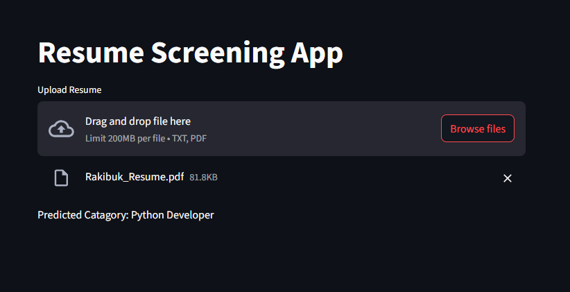

# Resume Screening App

A lightweight resume classification tool built with **Streamlit** and **scikit-learn**, designed to help recruiters or job portals automatically categorize resumes into job sectors using a trained machine learning model.

---

## Author

**Shakil Ahammed**
- GitHub: [@aidevshakil](https://github.com/aidevshakil)
- Email: aidevshakilinfo@gmail.com

---

## Features

- **Resume Upload** — Upload resumes in `.txt` or `.pdf` format
- **Resume Cleaning** — Preprocesses resume text (removes URLs, symbols, hashtags, mentions, etc.)
- **Job Role Classifier** — Predicts job categories using a pre-trained ML model
- **Instant Output** — View predicted category within seconds
- **Simple & Fast** — Minimal interface with direct results

---

## Supported Job Categories

The model can classify resumes into 24 categories:

| Category | Category | Category |
|---|---|---|
| Data Science | HR | Advocate |
| Arts | Web Designing | Mechanical Engineer |
| Sales | Health and Fitness | Civil Engineer |
| Java Developer | Business Analyst | SAP Developer |
| Automation Testing | Electrical Engineering | Operations Manager |
| Python Developer | DevOps Engineer | Network Security Engineer |
| PMO | Database | Hadoop |
| ETL Developer | DotNet Developer | Blockchain |
| Testing | | |

---

## Technology Stack

| Component | Technology |
|---|---|
| Web Framework | Streamlit |
| Machine Learning | scikit-learn |
| Text Preprocessing | `re`, `nltk` |
| Model Files | `clf.pkl`, `tfidf.pkl` |
| Text Encoding | UTF-8 with latin-1 fallback |

---

## Prerequisites

- Python 3.8+
- Pre-trained ML model saved as `clf.pkl`
- Pre-trained TF-IDF vectorizer saved as `tfidf.pkl`

---

## Installation

1. **Clone the repository**

```bash
git clone https://github.com/aidevshakil/Resume_Screening.git
cd Resume_Screening
```

2. **Create a virtual environment**

```bash
python -m venv venv
venv\Scripts\activate
```

3. **Install dependencies**

```bash
pip install -r requirements.txt
```

---

## Usage

1. **Start the application**

```bash
streamlit run app.py
```

2. Open your browser at `http://localhost:8501`
3. Upload a resume file (`.txt` or `.pdf`)
4. The predicted job category will be displayed instantly

---

## Project Structure

```
Resume_Screening/
├── app.py                      # Main Streamlit application
├── clf.pkl                     # Pre-trained classifier model
├── tfidf.pkl                   # Pre-trained TF-IDF vectorizer
├── UpdatedResumeDataSet.csv    # Dataset used for training
├── Resume_Screening.ipynb      # Training notebook
├── requirements.txt            # Python dependencies
├── screenshots/
│   └── Screenshot1.png
└── README.md
```

---

## How It Works

1. **File Upload** — Resume file is uploaded and decoded (UTF-8 / latin-1)
2. **Preprocessing** — Text is cleaned using regex (removes URLs, symbols, non-ASCII characters)
3. **Feature Extraction** — Cleaned text is converted into TF-IDF features
4. **Prediction** — The ML classifier predicts a job category
5. **Result** — The predicted category is displayed on screen

---

## Screenshots



---

## Contributing

Contributions are welcome! Feel free to open an issue or submit a pull request.

---

## License

This project is open source and available under the [MIT License](LICENSE).
